# KeyNography — Despliegue Multi-Cloud (AWS + Azure)

> **Versión:** 1.1 · **Estado:** Propuesta alineada con la IaC actual (`terraform-keynography/infra`)
> **Alcance:** Aplicación Laravel 12 + API FastAPI + MySQL + Pusher, desplegada en AWS y Azure con CI/CD vía GitHub Actions.
>
> **Aclaración importante:** el Terraform despliega **ECS Fargate**, no Elastic Beanstalk, y usa **MySQL 8** (no PostgreSQL). El DR de Azure ya está implementado en IaC y reutiliza las mismas imágenes de Docker Hub: no se crea ACR ni se suben imágenes otra vez. Donde este documento dice "actual", se refiere al código de `terraform-keynography/infra`.

---

## Tabla de contenidos

1. [Resumen ejecutivo](#1-resumen-ejecutivo)
2. [Arquitectura de alto nivel](#2-arquitectura-de-alto-nivel)
3. [Modelo C4](#3-modelo-c4)
   - [3.1 Diagrama de contexto](#31-diagrama-de-contexto)
   - [3.2 Diagrama de contenedores](#32-diagrama-de-contenedores)
4. [Despliegue en AWS](#4-despliegue-en-aws)
5. [Despliegue en Azure](#5-despliegue-en-azure)
6. [DNS, balanceo y alta disponibilidad](#6-dns-balanceo-y-alta-disponibilidad)
7. [CI/CD completo](#7-cicd-completo)
   - [7.1 Estrategia de ramas y entornos](#71-estrategia-de-ramas-y-entornos)
   - [7.2 Pipeline de la aplicación](#72-pipeline-de-la-aplicacin)
   - [7.3 Pipeline de la API](#73-pipeline-de-la-api)
   - [7.4 Flujo de despliegue y rollback](#74-flujo-de-despliegue-y-rollback)
8. [Flujos de datos y secuencias](#8-flujos-de-datos-y-secuencias)
9. [Observabilidad y operaciones](#9-observabilidad-y-operaciones)
10. [Continuidad de negocio y failover](#10-continuidad-de-negocio-y-failover)
11. [Costos estimados (créditos académicos)](#11-costos-estimados-crditos-acadmicos)
12. [Roadmap de implementación](#12-roadmap-de-implementacin)
13. [Estado real de IaC y próximos cambios](#13-estado-real-de-iac-y-prximos-cambios)

> Los diagramas están en **PlantUML**. Para verlos renderizados usa la extensión de PlantUML de VS Code, o pégalos en [plantuml.com](https://www.plantuml.com/plantuml).

---

## 1. Resumen ejecutivo

KeyNography se despliega de forma **multi-cloud activa-activa lógica**: la misma aplicación corre en **AWS** y en **Azure** de forma independiente, cada nube con su propia base de datos y almacenamiento. Un DNS con *failover routing* (Route 53) envía el tráfico al proveedor primario (AWS) y conmutaría automáticamente a Azure si AWS deja de responder.

| Componente | AWS (primario, implementado) | Azure (secundario / DR, propuesto) |
|---|---|---|
| Frontend + Backend Laravel | ECS Fargate | Azure Container Apps |
| API FastAPI | ECS Fargate | Azure Container Apps |
| Base de datos MySQL | RDS MySQL 8 `db.t3.micro` Multi-AZ | Azure Database for MySQL Flexible `B1ms` |
| Archivos generados (audio/imagen) | S3 (lo intenta la API con `boto3`) | Azure Blob Storage (requiere cambio de código) |
| Balanceo / TLS | ALB externo + ALB interno, **HTTP:80 hoy** (ACM pendiente) | Ingress HTTPS gestionado de Container Apps |
| Registro de imágenes | Docker Hub (imágenes actuales) | Las mismas imágenes de Docker Hub (sin ACR) |
| Realtime | Pusher (SaaS, común a ambos) | Pusher (SaaS, común a ambos) |
| DNS / Failover | Route 53 health check HTTP:80 | Route 53 health check HTTPS:443 |

**Decisión clave:** se reutilizan los `Dockerfile` existentes, por lo que el despliegue es "build → push registry → nueva revisión/task", sin reescribir la aplicación. Lo que sí cambia en Azure es el almacenamiento de archivos: la API hoy depende de `boto3`/S3.

---

## 2. Arquitectura de alto nivel

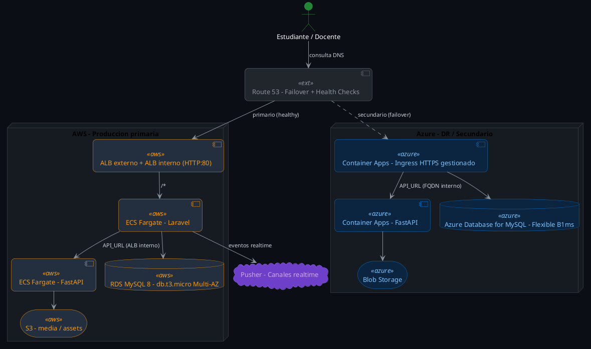

**Flujo resumido:** el usuario resuelve el dominio → Route 53 decide AWS o Azure según health check → el balanceador/ingress enruta al contenedor Laravel o a la API según la ruta → la app persiste en su MySQL regional y guarda archivos generados en el object storage de su nube.

---

## 3. Modelo C4

### 3.1 Diagrama de contexto

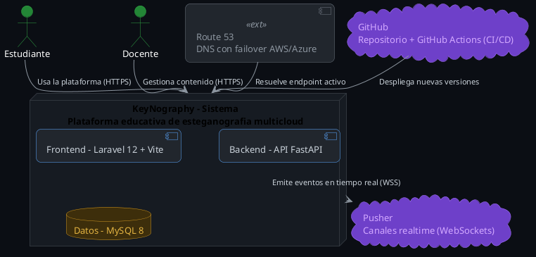

### 3.2 Diagrama de contenedores

```plantuml
@startuml KeyNography - Diagrama de Contenedores (C4 Nivel 2 MultiCloud)
!pragma layout smetana
left to right direction
skinparam backgroundColor #0B0E14
skinparam shadowing false
skinparam defaultFontName "Segoe UI"
skinparam defaultFontSize 12
skinparam roundcorner 14
skinparam nodesep 40
skinparam ranksep 60
skinparam ArrowColor #8B949E
skinparam ArrowFontColor #C9D1D9
skinparam ArrowFontSize 11
skinparam actor {
  BackgroundColor #238636
  BorderColor #2EA043
  FontColor #FFFFFF
}
skinparam node {
  BackgroundColor #161B22
  BorderColor #30363D
}
skinparam component {
  BackgroundColor #21262D
  BorderColor #58A6FF
  FontColor #C9D1D9
}
skinparam component<<aws>> {
  BackgroundColor #232F3E
  BorderColor #FF9900
  FontColor #FF9900
}
skinparam component<<azure>> {
  BackgroundColor #0B2540
  BorderColor #0078D4
  FontColor #7CC4FF
}
skinparam database<<aws>> {
  BackgroundColor #232F3E
  BorderColor #FF9900
  FontColor #FF9900
}
skinparam database<<azure>> {
  BackgroundColor #0B2540
  BorderColor #0078D4
  FontColor #7CC4FF
}
skinparam storage<<aws>> {
  BackgroundColor #232F3E
  BorderColor #FF9900
  FontColor #FF9900
}
skinparam storage<<azure>> {
  BackgroundColor #0B2540
  BorderColor #0078D4
  FontColor #7CC4FF
}
skinparam component<<ext>> {
  BackgroundColor #21262D
  BorderColor #6E7681
  FontColor #8B949E
}
skinparam cloud {
  BackgroundColor #6E40C9
  BorderColor #A371F7
  FontColor #D2A8FF
}

actor "Usuario (navegador)" as user

node "AWS - Cluster primario" {
  component "ALB externo + interno - balanceo y health checks" as alb <<aws>>
  component "App Laravel - ECS Fargate" as eb_app <<aws>>
  component "API FastAPI - ECS Fargate (7000)" as eb_api <<aws>>
  database "MySQL 8 - RDS db.t3.micro Multi-AZ" as rds <<aws>>
  storage "S3 - Object Storage" as s3 <<aws>>
}

node "Azure - DR / Secundario" {
  component "Ingress - HTTPS gestionado (Container Apps)" as ca_ingress <<azure>>
  component "App Laravel - misma imagen Docker" as ca_app <<azure>>
  component "API FastAPI - misma imagen Docker" as ca_api <<azure>>
  database "MySQL Flexible - B1ms" as azdb <<azure>>
  storage "Blob Storage" as blob <<azure>>
}

cloud "Pusher" as pusher
component "Route 53" as r53 <<ext>>

user --> r53 : DNS lookup
r53 --> alb : Endpoint primario (HTTP hoy)
r53 ..> ca_ingress : Endpoint secundario (HTTPS)
alb --> eb_app : /*
eb_app --> eb_api : API_URL (ALB interno)
eb_app --> rds : SQL
eb_api --> s3 : Archivos (boto3)
eb_app --> pusher : Eventos (WSS)
ca_ingress --> ca_app : HTTPS
ca_app --> ca_api : API_URL (FQDN interno)
ca_app --> azdb : SQL
ca_api --> blob : Archivos (requiere cambio de código)
@enduml
```

---

## 4. Despliegue en AWS

### 4.1 Servicios utilizados (créditos académicos AWS Academy / AWS Educate)

| Servicio | Uso | Capa gratuita / créditos |
|---|---|---|
| **ECS Fargate** | 2 servicios: Laravel y FastAPI | Se paga por vCPU/GB-s; bajo consumo en el MVP |
| **Application Load Balancer** | 2 ALB: externo (público) e interno (`API_URL`) | ~$16–22/mes **cada uno** — cubierto por créditos |
| **RDS MySQL 8 `db.t3.micro`** | Base de datos (`keynography`) | Configurado con `multi_az = true`, así que no es gratis |
| **S3** | Intento de subida de archivos desde la API | Primeros 5 GB gratis permanente |
| **ACM** | Certificado TLS para los ALB | Gratis, pero **aún no configurado**: los listeners son HTTP:80 |
| **Route 53** | Failover + health checks | Hosted zone $0.50/mes + queries mínimas |
| **Docker Hub / ECR** | Registro de imágenes | Las imágenes actuales son de Docker Hub; ECR es opcional |
| **CloudWatch** | Logs y métricas | Tier básico gratis |

> **Nota honesta sobre "gratuito":** los ALB, Fargate y RDS no tienen free tier permanente en AWS; se cubren con **créditos de AWS Academy** (típicamente $100–200) o del free tier del primer año. Son el coste principal del despliegue.

### 4.2 Topología AWS

```plantuml
@startuml AWS - Topologia de Red y Alta Disponibilidad
left to right direction
!pragma layout smetana
skinparam backgroundColor #0B0E14
skinparam shadowing false
skinparam defaultFontName "Segoe UI"
skinparam defaultFontSize 12
skinparam roundcorner 14
skinparam nodesep 35
skinparam ranksep 50
skinparam ArrowColor #8B949E
skinparam ArrowFontColor #C9D1D9
skinparam ArrowFontSize 11
skinparam node {
  BackgroundColor #161B22
  BorderColor #30363D
}
skinparam component {
  BackgroundColor #21262D
  BorderColor #58A6FF
  FontColor #C9D1D9
}
skinparam component<<aws>> {
  BackgroundColor #232F3E
  BorderColor #FF9900
  FontColor #FF9900
}
skinparam database<<aws>> {
  BackgroundColor #232F3E
  BorderColor #FF9900
  FontColor #FF9900
}
skinparam storage<<aws>> {
  BackgroundColor #232F3E
  BorderColor #FF9900
  FontColor #FF9900
}
skinparam component<<ext>> {
  BackgroundColor #21262D
  BorderColor #6E7681
  FontColor #8B949E
}
skinparam cloud {
  BackgroundColor #6E40C9
  BorderColor #A371F7
  FontColor #D2A8FF
}

component "Internet / Usuarios" as internet <<ext>>
component "Route 53 + Health Checks" as r53 <<ext>>

node "AWS Cloud - Region us-east-1" {
  node "VPC 10.0.0.0/16" {
    node "Public Subnets (2 AZs)" {
      component "ALB externo (HTTP:80)" as alb <<aws>>
    }
    node "Private Subnets - Compute" {
      component "ECS Fargate - Laravel (2 tareas)" as fargate_app <<aws>>
      component "ALB interno (HTTP:80)" as intalb <<aws>>
      component "ECS Fargate - FastAPI (2 tareas)" as fargate_api <<aws>>
    }
    node "Private Subnets - Data" {
      database "RDS MySQL 8 - db.t3.micro Multi-AZ" as rds <<aws>>
    }
  }
  storage "S3 - bucket configurado por S3_BUCKET_NAME" as s3 <<aws>>
  component "Task definition - variables y secretos" as sm <<aws>>
  component "CloudWatch - Logs + Metricas" as cw <<aws>>
}

cloud "Pusher" as pusher

internet --> r53 : DNS
r53 --> alb : healthy -> DNS del ALB
alb --> fargate_app : /*
fargate_app --> intalb : API_URL
intalb --> fargate_api : puerto 7000
fargate_app --> rds : SQL (puerto 3306)
fargate_app --> sm : APP_KEY / DB_PASSWORD / PUSHER
fargate_api --> s3 : intento de subida (boto3)
fargate_app --> pusher : eventos realtime (WSS)
fargate_app ..> cw : logs y metricas
fargate_api ..> cw : logs y metricas
@enduml
```

### 4.3 Decisiones de diseño AWS

- **ECS Fargate (ya implementado)**: los módulos `vpc`, `alb`, `ecs` y `rds` de `terraform-keynography/infra` son la fuente de verdad. No se planea migrar a Elastic Beanstalk.
- **Dos ALB, sin ruteo por path**: el ALB externo envía todo a Laravel; Laravel llama a la API por `API_URL`, que apunta al ALB interno. No existe `/api/*` en el código actual.
- **Health checks**: ALB externo contra `/` de Laravel; ALB interno contra `/health` de FastAPI. ECS reemplaza tareas unhealthy.
- **RDS MySQL 8 Multi-AZ**: `db.t3.micro` en `terraform.tfvars`, `multi_az = true` en el módulo, cifrado y 7 días de backup. Es un coste real, no free tier.
- **Secretos**: hoy `APP_KEY` y las claves Pusher están en claro en `modules/ecs/main.tf` y `db_password` en `terraform.tfvars`. Deben moverse a variables `sensitive`/Key Vault; si se rota `APP_KEY`, usar el **mismo valor en AWS y Azure** para no invalidar sesiones en el failover.
- **Storage real**: Laravel usa `FILESYSTEM_DISK=local` y escribe en `public/infected_files/` y `public/extracted_files/`; no hay EFS ni S3 en Laravel. La API intenta subir a S3 con `boto3`, pero si falla igual devuelve `file_base64` y el flujo sigue.
- **Pusher** se mantiene como SaaS común a ambos proveedores (WebSockets gestionados; el free tier de Pusher alcanza para el proyecto).

### 4.4 Variables de entorno AWS (ejemplo)

```env
# Valores inyectados hoy por modules/ecs/main.tf
APP_ENV=production
APP_URL=http://<ext_alb_dns>
API_URL=http://<int_alb_dns>
DB_CONNECTION=mysql
DB_HOST=<rds-endpoint>
DB_PORT=3306
DB_DATABASE=keynography
DB_USERNAME=keynography_user
FILESYSTEM_DISK=local
QUEUE_CONNECTION=database
PUSHER_APP_ID=...
PUSHER_APP_KEY=...
PUSHER_APP_SECRET=...
PUSHER_APP_CLUSTER=...
```

La task definition de la API Python solo inyecta `APP_ENV=production`; `S3_BUCKET_NAME` y las credenciales AWS **no están configuradas en Terraform**, así que la API usa los valores por defecto del código. En Azure Terraform ya inyecta `STORAGE_BACKEND`, `AZURE_STORAGE_ACCOUNT_NAME` y `AZURE_STORAGE_CONTAINER_NAME`, pero la API todavía no las lee.

---

## 5. Despliegue en Azure

### 5.1 Servicios utilizados (Azure for Students — $100 crédito + servicios gratuitos)

| Servicio | Uso | Capa gratuita / créditos |
|---|---|---|
| **Azure Container Apps** | Hosting Laravel + FastAPI (consumo) | ~180 000 vCPU-s y 2M requests/mes gratis; HTTPS ingress gestionado (equivale a LB+TLS) |
| **Docker Hub** | Imágenes existentes del front y la API | No se crea ACR: Azure usa las mismas imágenes |
| **Azure NAT Gateway** | Salida a Internet de Container Apps | De pago: ~$33/mes |
| **Azure Database for MySQL Flexible Server** | MySQL `B1ms` Burstable | De pago con el crédito de $100 |
| **Azure Blob Storage** | Medios generados | 5 GB gratis 12 meses |
| **Azure DNS** *(opcional)* | Zona DNS | $0.50/mes por zona |
| **Azure Monitor / Log Analytics** | Logs y métricas | 5 GB/mes gratis |
| **Azure Key Vault** | Secretos | Operaciones gratuitas generosas |

### 5.2 Topología Azure

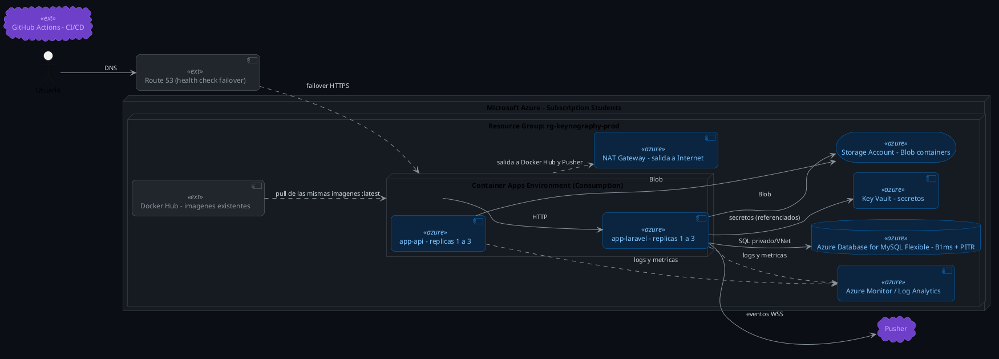

### 5.3 Decisiones de diseño Azure

- **Container Apps en Consumption plan**: escala a cero opcional, réplicas mínimas configurables, HTTPS automático con certificado gestionado → cubre "balanceo" sin administrar un Load Balancer explícito (equivalente PaaS al ALB de AWS).
- **Misma imagen Docker** que en AWS → paridad real multi-cloud, un solo `docker build` sirve para ambos.
- **MySQL Flexible Server B1ms**: el tier gratuito de 12 meses encaja con el crédito de Azure for Students.
- **Réplicas `min=1, max=3`**: HA limitada (una sola región); el failover real lo da Route 53 hacia/desde AWS. Para HA intra-Azure se puede subir a `min=2` (costo bajo en consumption).
- **Sin replicación automática de datos** entre RDS y MySQL en el MVP (complejidad alta). Estrategia: **cold standby** — la BD de Azure se mantiene migrada periódicamente (dump/restauración) y se promueve manualmente en failover. Ver sección 10.
- **Subnetes delegadas**: MySQL Flexible necesita `Microsoft.DBforMySQL/flexibleServers` y Container Apps `Microsoft.App/environments`; no pueden compartir subred.
- **Nombres globales**: Storage Account, Key Vault y MySQL Flexible exigen nombres únicos globalmente; no reutilizar `app_name = "mi-app"`.
- **Autenticación del provider**: `terraform plan` en Azure requiere `ARM_SUBSCRIPTION_ID`, `ARM_CLIENT_ID`, `ARM_CLIENT_SECRET` y `ARM_TENANT_ID` (o login interactivo), además de `features {}` en el provider.

### 5.4 Cambios de aplicación necesarios en Azure

- **Backend (imprescindible)**: `app/libs/utils.py` usa `boto3` para S3. Para que Azure sea independiente hay que soportar Azure Blob Storage (`azure-storage-blob`) y registrar la dependencia en `requirements.txt`.
- **Frontend (no imprescindible)**: Laravel usa `FILESYSTEM_DISK=local`; no hay que tocarlo para arrancar en Azure. Queda como limitación que los archivos generados en una nube no existen en la otra tras un failover.
- **Sesiones**: usar el mismo `APP_KEY` en AWS y Azure para que el failover no cierre las sesiones; guardarlo como secreto, no en el repo.

---

## 6. DNS, balanceo y alta disponibilidad

### 6.1 Estrategia DNS con Route 53

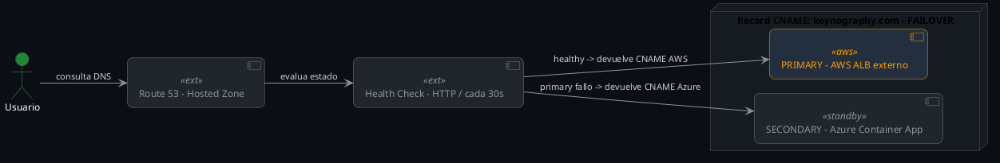

- **Failover routing** (no simple latency): Route 53 devuelve AWS si el health check pasa; si falla de forma sostenida, devuelve Azure automáticamente (DNS TTL ~60s → propagación rápida).
- **CNAME, no alias**: un alias de Route 53 no puede apuntar al FQDN de Azure Container Apps. Para el apex (`keynography.com`) haría falta un registro `A` con una IP pública reservada; el CNAME se usa en subdominios (`www`, `app`).
- **Solo el front se expone**: la API se llama por `API_URL` (ALB interno en AWS, FQDN interno en Azure). No publicar `api.keynography.com` si no se añade antes un listener público en el ALB externo.
- **Health checks HTTP**: los ALB actuales solo escuchan HTTP:80 y no hay certificado ACM. Usar `GET /` en Laravel y `GET /health` en la API; si se configura HTTPS después, migrar los health checks.
- Coste: health checks adicionales ~$0.50/mes c/u — trivial con créditos.
- **Limitación conocida**: el failover es de *aplicación*, no de datos ni de archivos generados. Ver sección 10.

### 6.1.1 Alternativa sin Route 53

Si se quiere cero costo: un único dominio con dos subdominios (`aws.dominio.com`, `azure.dominio.com`) y conmutación manual documentada. Route 53 failover es la versión "pro" y recomendable para el proyecto.

### 6.2 Alta disponibilidad por nube

| Capa | AWS | Azure |
|---|---|---|
| Compute | ECS Fargate: 2 tareas por servicio en 2 AZs, health checks ALB | Container Apps min 1–2 réplicas, réplicas en distintos nodos |
| Datos | RDS MySQL 8 Multi-AZ (7 días de backup) | MySQL Flexible con alta disponibilidad opcional (costo extra) |
| TLS | Sin TLS hoy (HTTP:80); ACM + listener 443 pendiente | Certificado gestionado en ingress |
| Recuperación | `terraform apply` de la task definition anterior + snapshots RDS | Revisión de revisiones de Container Apps + backups MySQL |

---

## 7. CI/CD completo

### 7.1 Estrategia de ramas y entornos

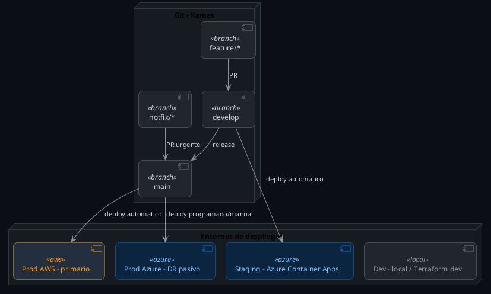

| Entorno | Despliegue | Propósito |
|---|---|---|
| Local | `php artisan serve` + `uvicorn` + docker-compose | Desarrollo |
| Staging | Azure Container Apps (`--environment staging`) | QA/pre-producción, además actúa como DR tibio |
| Producción AWS | ECS cluster con servicios Laravel y Python (Terraform) | Primario, failover origen |
| Producción Azure | Container Apps prod | DR pasivo; mismo artefacto inmutable |

**Principio:** un artefacto Docker inmutable por commit → el mismo `sha256` corre en staging y en ambas nubes. Nada de "en mi máquina funcionaba".

### 7.2 Pipeline de la aplicación (Laravel)

```yaml
# .github/workflows/deploy-app.yml  (extracto)
name: Deploy App
on:
  push:
    branches: [main]
  pull_request:
    branches: [main]

env:
  AWS_REGION: us-east-1
  ECS_CLUSTER: mi-app-cluster
  ECS_SERVICE_APP: mi-app-laravel-service
  ECS_SERVICE_API: mi-app-python-service

jobs:
  test:
    runs-on: ubuntu-latest
    steps:
      - uses: actions/checkout@v4
      - uses: shivammathur/setup-php@v2
        with: { php-version: '8.3', extensions: sqlite }
      - run: composer install --no-interaction --prefer-dist
      - run: php artisan test            # PHPUnit
      - run: npm ci && npm run build     # Vite assets

  docker:
    needs: test
    runs-on: ubuntu-latest
    outputs: { tag: ${{ steps.meta.outputs.tags }} }
    steps:
      - uses: docker/setup-buildx-action@v3
      - uses: docker/login-action@v3
        with:
          username: ${{ secrets.DOCKERHUB_USERNAME }}
          password: ${{ secrets.DOCKERHUB_TOKEN }}
      - uses: docker/build-push-action@v5
        with:
          context: .
          push: true
          tags: isaacdavid1234/keynography-app:latest

  deploy-aws:
    needs: docker
    runs-on: ubuntu-latest
    environment: production-aws
    steps:
      - uses: aws-actions/configure-aws-credentials@v4
        with:
          role-to-assume: ${{ secrets.AWS_DEPLOY_ROLE }}
          aws-region: ${{ env.AWS_REGION }}
      - name: Deploy ECS Fargate (nueva task definition)
        run: |
          # Actualizar la task definition con la imagen nueva y luego:
          aws ecs update-service \
            --cluster "$ECS_CLUSTER" \
            --service "$ECS_SERVICE_APP" \
            --force-new-deployment \
            --region "$AWS_REGION"

  deploy-azure:
    needs: docker
    runs-on: ubuntu-latest
    environment: production-azure
    steps:
      - uses: azure/login@v2
        with:
          creds: ${{ secrets.AZURE_CREDENTIALS }}          # Service Principal (OIDC recomendado)
      - run: |
          # No se sube imagen: Azure ya apunta a las mismas imagenes de Docker Hub.
          az containerapp update \
            --name keynography-app \
            --resource-group keynography-rg \
            --image isaacdavid1234/keynography-app:latest
          az containerapp update \
            --name keynography-api \
            --resource-group keynography-rg \
            --image isaacdavid1234/keynography-api:latest
```

> **Detalle práctico:** las imágenes `isaacdavid1234/keynography-app:latest` e `isaacdavid1234/keynography-api:latest` ya están en Docker Hub y Terraform las reutiliza en AWS y Azure. Para publicar una versión nueva, actualiza el tag en `terraform.tfvars` y vuelve a aplicar; no hace falta un registro nuevo.

### 7.3 Pipeline de la API (FastAPI)

Mismo patrón, con `pytest` + lint (`ruff`) en lugar de PHPUnit y el `Dockerfile` de `Esteganografia_Python_API`. El contenedor escucha en **7000**; en AWS se expone por el **ALB interno** y Laravel lo consume vía `API_URL`. No existe ruteo público `/api/*`.

### 7.4 Flujo de despliegue y rollback

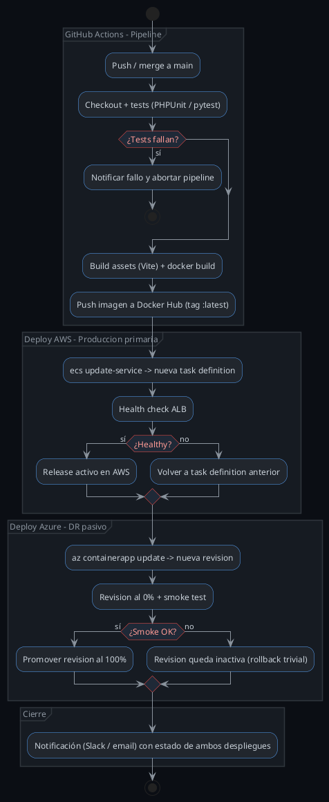

- **AWS/ECS**: rollback = volver a la task definition anterior y ejecutar `ecs update-service`; Terraform también permite reaplicar el commit previo.
- **Azure/Container Apps**: las revisiones inmutables permiten *traffic splitting* — se despliega la nueva revisión al 0%, se hace smoke test y se promueve al 100%. Rollback = re-etiquetar la revisión anterior.
- **Smoke tests post-deploy** en ambos: `curl /up`, login de prueba, un ciclo esteganografía→descarga.

### 7.5 Diagrama completo del pipeline

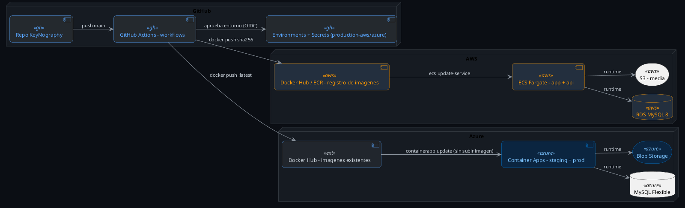

---

## 8. Flujos de datos y secuencias

### 8.1 Flujo principal: esteganografía de imagen

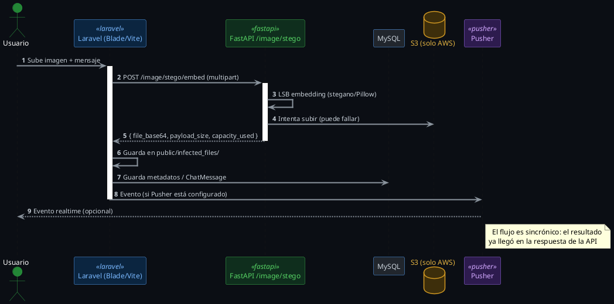

### 8.2 Flujo de lectura de archivos generados

Hoy **no hay URLs prefirmadas ni SAS tokens**: la API devuelve el archivo en `file_base64` y Laravel lo escribe en `public/infected_files/` o `public/extracted_files/`. El intento de subida a S3 es solo un efecto secundario y sus errores no rompen el flujo. Para Azure habría que sustituir `boto3` por `azure-storage-blob` y decidir si Laravel pasa a servir desde Blob; hasta entonces, un failover no arrastra los archivos generados en la otra nube.

---

## 9. Observabilidad y operaciones

| Capacidad | AWS | Azure |
|---|---|---|
| Logs | CloudWatch Logs (`/ecs/{app_name}/laravel`, `/ecs/{app_name}/python`) | Log Analytics (Container Apps envía automático) |
| Métricas | CloudWatch (CPU, ALB 5xx, RDS) | Azure Monitor / Container Apps metrics |
| Errores app | `php artisan` logs → CloudWatch; Sentry *(opcional, free tier)* | Igual → Log Analytics |
| Uptime | Route 53 health checks cada 30 s | Mismos health checks |
| Alertas | CloudWatch Alarms → SNS email (gratis) | Azure Monitor alert rules → email |

Recomendación ligera: **Sentry free tier** (5k errores/mes) en ambas nubes para excepciones de Laravel y FastAPI — un solo panel para el sistema multicloud.

---

## 10. Continuidad de negocio y failover

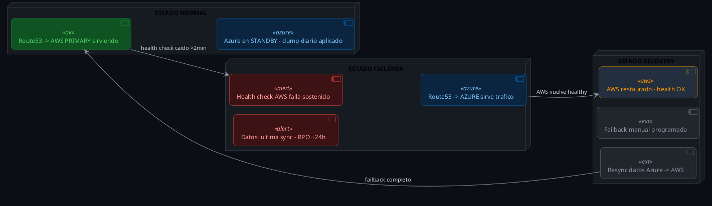

| Métrica | Objetivo MVP | Notas |
|---|---|---|
| **RTO** (tiempo de recuperación) | ~5–15 min | Automático vía DNS; depende del TTL (60s) |
| **RPO** (pérdida de datos) | 24 h (dump diario) | Aceptable para contenido educativo; mejora futura: binlog replication gestionada |
| **Failback** | Manual, ventana programada | Re-sincronizar BD antes de volver el tráfico |

**Procedimiento de failover (runbook):**
1. Confirmar health check caído en Route 53 (o forzar con "Failover" manual en consola).
2. Verificar que Azure responde y que la BD tiene el último dump.
3. DNS conmuta solo; comunicar a usuarios.
4. Post-incidente: restaurar AWS, resincronizar datos, documentar.

---

## 11. Costos estimados (créditos académicos)

| Concepto | AWS/mes | Azure/mes | Notas |
|---|---|---|---|
| ALB externo + interno | ~$32–44 | — | Dos ALB, ~$16–22 cada uno; el coste fijo principal |
| Compute app+api | Bajo (Fargate: Laravel 0.5 vCPU/1 GB, API 0.25 vCPU/0.5 GB) | ~$0–10 (consumption) | Escalado según réplicas |
| Base de datos | ~$25–30 (RDS `db.t3.micro` **Multi-AZ**) | $0 (12 meses gratis B1ms) | Multi-AZ duplica el coste de RDS |
| Storage | <$1 (S3 5 GB gratis) | $0–2 (Blob) | |
| DNS/health checks | ~$1.50 | — | Route 53 |
| **Total estimado** | **~$60–80** | **~$0–12** | Orden de magnitud; cubierto por créditos académicos |

Presupuesto sugerido de créditos: **AWS ~$80/mes**, **Azure ~$20/mes**. AWS es el que más consume por los dos ALB y RDS Multi-AZ; si hay que bajar coste, el primer candidato es pasar RDS a Single-AZ (cambio de infraestructura, requiere plan y ventana de mantenimiento).

---

## 12. Roadmap de implementación

| Fase | Entregable | Dependencias |
|---|---|---|
| **0. Prep** | Dockerfiles validados, health endpoints (`/`, `/health`) | — |
| **1. AWS base (ya hecho)** | Terraform con VPC, ALB externo/interno, ECS Fargate, RDS MySQL 8 | Cuenta AWS Academy activa |
| **2. CI/CD AWS** | Workflow test → imagen → `ecs update-service` con OIDC | Fase 1 |
| **3. Azure base (ya hecho)** | Provider `azurerm`, Resource Group, VNet con subnetes delegadas, NAT Gateway, MySQL Flexible, Storage, Key Vault, Log Analytics y Container Apps con las imágenes de Docker Hub | Azure for Students activo |
| **4. Cambio de aplicación** | `boto3` → `azure-storage-blob` en la API; mismos `APP_KEY` y secretos Pusher en ambas nubes | Fase 3 |
| **5. DNS + failover** | Route 53: CNAME failover + health check HTTP:80 en AWS y HTTPS:443 en Azure | Dominio y hosted zone existentes |
| **6. DR + runbook** | Dump/restauración programada, simulacro de failover | Fase 5 |
| **7. Endurecimiento** | ACM + listener 443 en AWS, secretos fuera del repo, alertas | Post-MVP |

---

## Anexo A — Checklist de variables de entorno por entorno

- `APP_ENV`, `APP_URL` (según ALB externo o FQDN de Container Apps)
- `APP_KEY`: **el mismo valor en AWS y Azure**, pero guardado como secreto, nunca en el repo
- `DB_*` (MySQL 3306, base `keynography`, usuario `keynography_user`; endpoint regional de cada nube)
- `FILESYSTEM_DISK=local` (hoy); la API ya recibe `STORAGE_BACKEND=azure`, `AZURE_STORAGE_ACCOUNT_NAME` y `AZURE_STORAGE_CONTAINER_NAME`, pero el código todavía usa `boto3`
- `QUEUE_CONNECTION`, `CACHE_STORE` (database en MVP)
- `PUSHER_*` (común)
- `API_URL`: ALB interno en AWS, FQDN interno de la Container App en Azure (nunca una URL pública)

## Anexo B — Decisiones descartadas (y por qué)

| Alternativa | Por qué no |
|---|---|
| Kubernetes (EKS/AKS) | Sobre-ingeniería para este proyecto; ECS Fargate + Container Apps dan el mismo resultado con 10% del esfuerzo |
| Elastic Beanstalk | El repositorio ya tiene Terraform con ECS Fargate; cambiar de herramienta no aporta y obligaría a rehacer el despliegue |
| Replicación activa de BD entre nubes | Complejidad y costo desproporcionados; cold standby + failover DNS cubre el requisito académico |
| Serverless puro (Lambda/Lambda Azure Functions) | Laravel monolítico + sesiones/cola no encaja sin refactor grande |
| Cloudflare como único DNS | Válido, pero Route 53 health checks + failover se integra mejor con AWS y es parte del temario |

---

## 13. Estado real de IaC y próximos cambios

### 13.1 Lo que ya existe en `terraform-keynography/infra`

- **Backend de estado**: S3 `diego-terraform-state-2026-05`, clave `infra/terraform.tfstate`, región `us-east-1`, cifrado y lock con DynamoDB `terraform_locks`. Como AWS sigue siendo primario, **no hay que migrar el estado**.
- **Proveedores**: `hashicorp/aws ~> 5.0` y `hashicorp/azurerm ~> 4.0` (este último con `features {}` y credenciales `ARM_*`).
- **Módulos**: `vpc`, `alb`, `ecs`, `rds` (AWS), `azure/network`, `azure/monitoring`, `azure/security`, `azure/storage`, `azure/database`, `azure/containers` y `dns` (Route 53).
- **RDS**: MySQL 8.0, `db.t3.micro` en `terraform.tfvars` (el default de `variables.tf` es `db.t3.medium`), `multi_az = true`, 20 GB gp3 cifrados, 7 días de backup, `skip_final_snapshot = false`.
- **Red**: VPC `10.0.0.0/16`, subredes públicas, privadas y de BD en 2 AZ.
- **ALB**: externo público e interno privado, ambos con listener **HTTP:80**. El externo apunta a Laravel; el interno a la API en el puerto 7000.
- **ECS**: 2 servicios Fargate (Laravel 512 CPU/1024 MB, API 256 CPU/512 MB). `APP_URL=http://<ext_alb_dns>` y `API_URL=http://<int_alb_dns>` (`modules/ecs/main.tf`). La task de la API solo inyecta `APP_ENV`. No se usa la variable `PYTHON_API_URL`.
- **Imágenes**: `isaacdavid1234/keynography-app:latest` e `isaacdavid1234/keynography-api:latest` (Docker Hub).
- **Secretos**: `APP_KEY` y credenciales Pusher aparecen en claro en `modules/ecs/main.tf`; `db_password`, `app_key` y `pusher_app_secret` están en `terraform.tfvars`. En Azure esos tres valores se guardan en Key Vault y se inyectan a Container Apps mediante secretos.
- **Azure implementado**: Resource Group `keynography-rg`, VNet `10.10.0.0/16`, subnet delegada `/27` para Container Apps y `/24` para MySQL, NSG y NAT Gateway `Standard` (SKU `StandardV2` no compatible).
- **MySQL en Azure**: Flexible `B_Standard_B1ms`, MySQL 8.0.21, zona 1, 20 GB, 7 días de backup, red privada con zona DNS `privatelink.mysql.database.azure.com`.
- **Container Apps**: Environment con workload profile `Consumption`, apps `keynography-app:80` y `keynography-api:7000`, 0-3 réplicas y las mismas imágenes `isaacdavid1234/keynography-*:latest`. No hay ACR.
- **DNS**: health checks y CNAME failover existen pero `failover_dns_enabled = false` por defecto; AWS se comprueba por HTTP:80 y Azure por HTTPS:443.
- El repo no tiene `.terraform/` inicializado, así que los comandos deben empezar con `terraform init`.

### 13.2 Cambios ya aplicados en Terraform

| Archivo | Cambio |
|---|---|
| `infra/main.tf` | Provider `azurerm`, locals de tags y llamadas a los siete módulos nuevos; backend S3 intacto |
| `infra/variables.tf`, `outputs.tf`, `terraform.tfvars` | Región Azure, subnets, nombres globales, secretos, FQDNs y bandera de DNS |
| `infra/modules/azure/network` | Resource Group, VNet, subnetes delegadas, NSG, IP pública y NAT Gateway |
| `infra/modules/azure/monitoring` | Log Analytics |
| `infra/modules/azure/security` | Managed Identity, Key Vault con RBAC, tres secretos y rol `Key Vault Secrets User` |
| `infra/modules/azure/storage` | Storage Account LRS + contenedor Blob privado |
| `infra/modules/azure/database` | MySQL Flexible B1ms, base `keynography` y DNS privada enlazada a la VNet |
| `infra/modules/azure/containers` | Container Apps Environment + Laravel y API con las imágenes de Docker Hub |
| `infra/modules/dns` | Health checks y CNAME failover; desactivado por defecto |
| `terraform-keynography/README.md` | Arquitectura, variables, outputs, coste y pasos de failover actualizados |

### 13.3 Reglas para no romper el despliegue actual

1. **No se tocaron** `modules/vpc`, `modules/alb`, `modules/ecs` ni `modules/rds`: AWS sigue igual.
2. **No migrar** `db.t3.micro` a otra clase ni `multi_az` a `false` sin una ventana de cambio: son recursos con estado real.
3. **No usar alias de Route 53** hacia Azure; usar CNAME en subdominios. El apex requiere otra solución.
4. **No health checks HTTPS en AWS** mientras no exista ACM + listener 443. Azure sí usa HTTPS:443 porque Container Apps ya termina TLS.
5. Los nombres de Storage Account, Key Vault y MySQL Flexible son globales: si Azure los rechaza, cámbialos en `terraform.tfvars`. No se crea ACR.
6. `terraform plan` fallará si no están definidas `ARM_SUBSCRIPTION_ID`, `ARM_CLIENT_ID`, `ARM_CLIENT_SECRET` y `ARM_TENANT_ID`, o si el service principal no puede asignar roles/escribir secretos.
7. El `APP_KEY` y las credenciales Pusher son los mismos en AWS y Azure para no invalidar sesiones durante el failover.
8. **No ejecutar `terraform destroy` sin revisar**: ahora el root contiene AWS y Azure. NAT Gateway cuesta ~$33/mes y MySQL B1ms ~$13/mes dentro de los $100 de crédito.
9. El backend todavía debe soportar Blob Storage en la API; sin ese cambio el DR seguiría intentando escribir en el S3 de AWS.

### 13.4 Validación

```bash
cd terraform-keynography/infra
export ARM_SUBSCRIPTION_ID=...
export ARM_CLIENT_ID=...
export ARM_CLIENT_SECRET=...
export ARM_TENANT_ID=...
terraform init
terraform validate
terraform plan
terraform apply
```

Revisar después `terraform output` (`ext_alb_dns`, `int_alb_dns`, `rds_endpoint`, `ecs_cluster`, `azure_app_fqdn`, `azure_api_fqdn`, `azure_mysql_fqdn`) y probar `/` en ambos FQDNs antes de activar `failover_dns_enabled`.
