# KeyNography — Despliegue Multi-Cloud (AWS + Azure)

> **Versión:** 1.0 · **Estado:** Propuesta de arquitectura
> **Alcance:** Aplicación Laravel 12 + API FastAPI + MySQL + Pusher, desplegada en AWS y Azure con CI/CD vía GitHub Actions.

---

## Tabla de contenidos

1. [Resumen ejecutivo](#1-resumen-ejecutivo)
2. [Arquitectura de alto nivel](#2-arquitectura-de-alto-nivel)
3. [Modelo C4](#3-modelo-c4)
   - [3.1 Diagrama de contexto](#31-diagrama-de-contexto)
   - [3.2 Diagrama de contenedores](#32-diagrama-de-contenedores)
4. [Despliegue en AWS](#4-despliegue-en-aws)
5. [Despliegue en Azure](#5-despliegue-en-azure)
6. [DNS, balanceo y alta disponibilidad](#6-dns-balanceo-y-alta-disponibilidad)
7. [CI/CD completo](#7-cicd-completo)
   - [7.1 Estrategia de ramas y entornos](#71-estrategia-de-ramas-y-entornos)
   - [7.2 Pipeline de la aplicación](#72-pipeline-de-la-aplicacin)
   - [7.3 Pipeline de la API](#73-pipeline-de-la-api)
   - [7.4 Flujo de despliegue y rollback](#74-flujo-de-despliegue-y-rollback)
8. [Flujos de datos y secuencias](#8-flujos-de-datos-y-secuencias)
9. [Observabilidad y operaciones](#9-observabilidad-y-operaciones)
10. [Continuidad de negocio y failover](#10-continuidad-de-negocio-y-failover)
11. [Costos estimados (créditos académicos)](#11-costos-estimados-crditos-acadmicos)
12. [Roadmap de implementación](#12-roadmap-de-implementacin)

> Los diagramas están en **PlantUML**. Para verlos renderizados usa la extensión de PlantUML de VS Code, o pégalos en [plantuml.com](https://www.plantuml.com/plantuml).

---

## 1. Resumen ejecutivo

KeyNography se despliega de forma **multi-cloud activa-activa lógica**: la misma aplicación corre en **AWS** y en **Azure** de forma independiente, cada nube con su propia base de datos y almacenamiento. Un DNS con *failover routing* (Route 53) envía el tráfico al proveedor primario (AWS) y conmutaría automáticamente a Azure si AWS deja de responder.

| Componente | AWS (primario) | Azure (secundario / DR) |
|---|---|---|
| Frontend + Backend Laravel | Elastic Beanstalk (Docker) | Azure Container Apps |
| API FastAPI | Elastic Beanstalk (Docker) | Azure Container Apps |
| Base de datos MySQL | RDS `db.t3.micro` | Azure Database for MySQL Flexible `B1ms` |
| Archivos generados (audio/imagen) | S3 | Azure Blob Storage |
| Balanceo / TLS | ALB (incluido en EB) + ACM | Ingress gestionado de Container Apps |
| Realtime | Pusher (SaaS, común a ambos) | Pusher (SaaS, común a ambos) |
| DNS / Failover | Route 53 (health checks) | Route 53 health checks |

**Decisión clave:** se reutilizan los `Dockerfile` existentes (`webdevops/php-nginx` para Laravel, imagen Python para FastAPI), por lo que el despliegue es "build peak → push registry → release", sin reescribir la aplicación.

---

## 2. Arquitectura de alto nivel

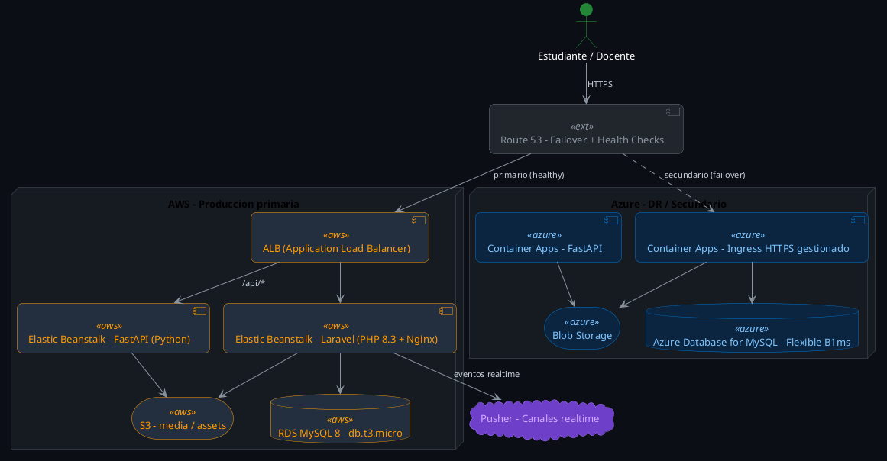

**Flujo resumido:** el usuario resuelve el dominio → Route 53 decide AWS o Azure según health check → el balanceador/ingress enruta al contenedor Laravel o a la API según la ruta → la app persiste en su MySQL regional y guarda archivos generados en el object storage de su nube.

---

## 3. Modelo C4

### 3.1 Diagrama de contexto

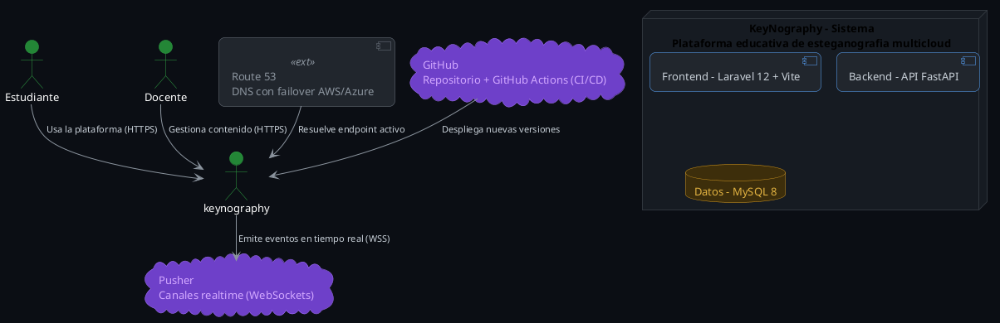

### 3.2 Diagrama de contenedores

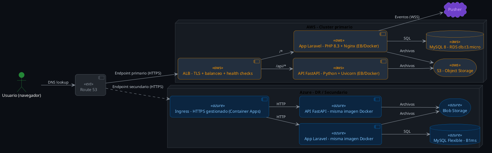

---

## 4. Despliegue en AWS

### 4.1 Servicios utilizados (créditos académicos AWS Academy / AWS Educate)

| Servicio | Uso | Capa gratuita / créditos |
|---|---|---|
| **Elastic Beanstalk** | Hosting Laravel + FastAPI (plataforma Docker) | Sin costo extra sobre EC2; incluye **ALB, ASG, health checks y auto-scaling** |
| **EC2 `t3.micro`/`t2.micro`** | Instancias detrás del ASG de EB | 750 h/mes gratis primer año; en Academy se cubre con créditos |
| **Application Load Balancer** | Terminación TLS + balanceo | ~$16–22/mes — **cubierto por créditos**; es el componente que habilita HA real |
| **RDS MySQL `db.t3.micro`** | Base de datos | 750 h/mes gratis primer año (Single-AZ); Multi-AZ duplica costo |
| **S3** | Medios generados + assets | Primeros 5 GB gratis permanente |
| **ACM** | Certificado TLS `*.keynography...` | Gratis |
| **Route 53** | Failover + health checks | Hosted zone $0.50/mes + queries mínimas |
| **ECR** | Registro de imágenes Docker | Primeros 500 MB/mes gratis |
| **CloudWatch** | Logs y métricas | Tier básico gratis |
| **SQS** *(opcional)* | Cola para jobs | 1M requests/mes gratis |

> **Nota honesta sobre "gratuito":** los servicios de balanceo (ALB) y RDS no tienen free tier permanente en AWS; dependen de los **créditos de AWS Academy** (típicamente $100–200) o del free tier del primer año. Es la opción correcta para cumplir el requisito de LB + HA.

### 4.2 Topología AWS

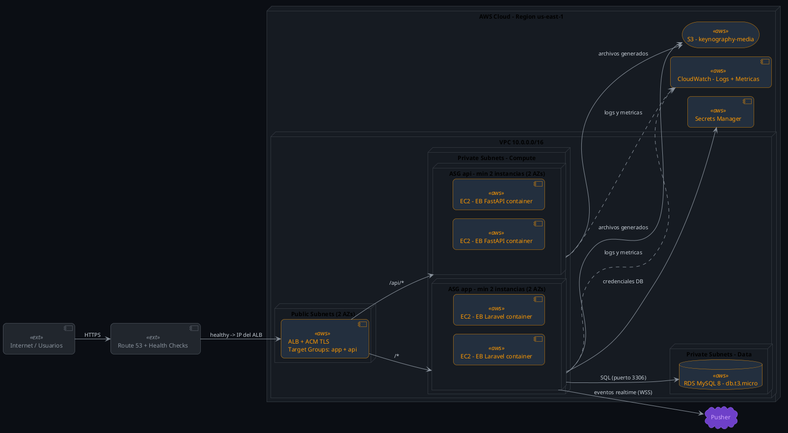

### 4.3 Decisiones de diseño AWS

- **Elastic Beanstalk con plataforma Docker**: se reutiliza el `Dockerfile` actual sin cambios. EB crea automáticamente el **ALB + ASG + health checks** → alta disponibilidad sin escribir infraestructura como código compleja (opcional: `eb cli`/`aws cloudformation` si se quiere IaC).
- **Ruteo por path**: `/api/*` → target group de FastAPI; el resto → Laravel. Alternativa más limpia a mediano plazo: subdominio `api.dominio.com` con *host-based routing*.
- **ASG mínimo 1, deseable 2**: para HA real se configura `min_size=2` repartidos en 2 AZs (costo doble de instancias, asumible con créditos). Health check del ALB reemplaza instancias unhealthy automáticamente.
- **RDS Single-AZ** para el MVP; el failover multicloud hacia Azure cubre el escenario de desastre. RDS Multi-AZ queda como mejora futura (~$25/mes extra).
- **Secretos** en AWS Secrets Manager (o variables de entorno del EB environment), nunca en el repo.
- **Storage**: el volumen `storage_data` de Laravel se monta en EFS si se escala a >1 instancia; en MVP con 1–2 instancias se usa disco local efímero + S3 para lo persistente. Los `generated_audios`/`generated_images` de la API van directo a S3.
- **Pusher** se mantiene como SaaS común a ambos proveedores (WebSockets gestionados; el free tier de Pusher alcanza para el proyecto).

### 4.4 Variables de entorno AWS (ejemplo)

```env
APP_ENV=production
APP_URL=https://keynography.tudominio.com
DB_CONNECTION=mysql
DB_HOST=<rds-endpoint>
DB_DATABASE=keynography
FILESYSTEM_DISK=s3
AWS_BUCKET=keynography-media
QUEUE_CONNECTION=database
API_URL=https://api.tudominio.com   # o https://dominio.com/api si se usa path routing
PUSHER_APP_ID=...
PUSHER_KEY=...
PUSHER_SECRET=...
PUSHER_CLUSTER=us2
```

---

## 5. Despliegue en Azure

### 5.1 Servicios utilizados (Azure for Students — $100 crédito + servicios gratuitos)

| Servicio | Uso | Capa gratuita / créditos |
|---|---|---|
| **Azure Container Apps** | Hosting Laravel + FastAPI (consumo) | ~180 000 vCPU-s y 2M requests/mes gratis; HTTPS ingress gestionado (equivale a LB+TLS) |
| **Azure Container Registry** | Imágenes Docker | Basic: 10 GB incluidos |
| **Azure Database for MySQL Flexible Server** | MySQL `B1ms` Burstable | **Gratis 12 meses** para estudiantes |
| **Azure Blob Storage** | Medios generados | 5 GB gratis 12 meses |
| **Azure DNS** *(opcional)* | Zona DNS | $0.50/mes por zona |
| **Azure Monitor / Log Analytics** | Logs y métricas | 5 GB/mes gratis |
| **Azure Key Vault** | Secretos | Operaciones gratuitas generosas |

### 5.2 Topología Azure

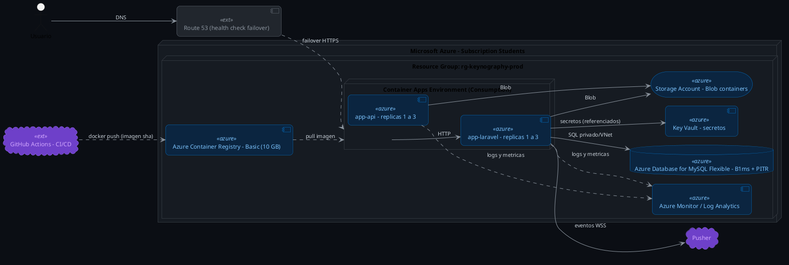

### 5.3 Decisiones de diseño Azure

- **Container Apps en Consumption plan**: escala a cero opcional, réplicas mínimas configurables, HTTPS automático con certificado gestionado → cubre "balanceo" sin administrar un Load Balancer explícito (equivalente PaaS al ALB de AWS).
- **Misma imagen Docker** que en AWS → paridad real multi-cloud, un solo `docker build` sirve para ambos.
- **MySQL Flexible Server B1ms**: el tier gratuito de 12 meses encaja con el crédito de Azure for Students.
- **Réplicas `min=1, max=3`**: HA limitada (una sola región); el failover real lo da Route 53 hacia/desde AWS. Para HA intra-Azure se puede subir a `min=2` (costo bajo en consumption).
- **Sin replicación automática de datos** entre RDS y MySQL en el MVP (complejidad alta). Estrategia: **cold standby** — la BD de Azure se mantiene migrada periódicamente (dump/restauración) y se promueve manualmente en failover. Ver sección 10.

---

## 6. DNS, balanceo y alta disponibilidad

### 6.1 Estrategia DNS con Route 53

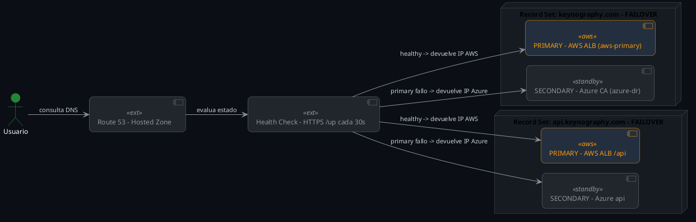

- **Failover routing** (no simple latency): Route 53 devuelve AWS si el health check pasa; si falla de forma sostenida, devuelve Azure automáticamente (DNS TTL ~60s → propagación rápida).
- Health check contra un endpoint barato: `GET /up` de Laravel o `GET /health` de FastAPI.
- Coste: health checks adicionales ~$0.50/mes c/u — trivial con créditos.
- **Limitación conocida**: el failover es de *aplicación*, no de datos. Ver sección 10.

### 6.1.1 Alternativa sin Route 53

Si se quiere cero costo: un único dominio con dos subdominios (`aws.dominio.com`, `azure.dominio.com`) y conmutación manual documentada. Route 53 failover es la versión "pro" y recomendable para el proyecto.

### 6.2 Alta disponibilidad por nube

| Capa | AWS | Azure |
|---|---|---|
| Compute | ASG min 2, 2 AZs, health checks ALB | Container Apps min 1–2 réplicas, réplicas en distintos nodos |
| Datos | RDS Single-AZ (+Multi-AZ opcional) | MySQL Flexible con alta disponibilidad opcional (costo extra) |
| TLS | ACM automático en ALB | Certificado gestionado en ingress |
| Recuperación | EB rollback + snapshots RDS | Revisión de revisiones de Container Apps + backups MySQL |

---

## 7. CI/CD completo

### 7.1 Estrategia de ramas y entornos

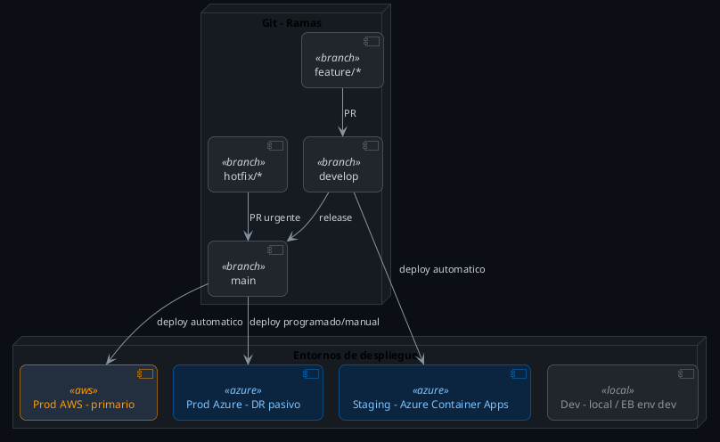

| Entorno | Despliegue | Propósito |
|---|---|---|
| Local | `php artisan serve` + `uvicorn` + docker-compose | Desarrollo |
| Staging | Azure Container Apps (`--environment staging`) | QA/pre-producción, además actúa como DR tibio |
| Producción AWS | EB environments `keynography-prod` + `keynography-api` | Primario, failover origen |
| Producción Azure | Container Apps prod | DR pasivo; mismo artefacto inmutable |

**Principio:** un artefacto Docker inmutable por commit → el mismo `sha256` corre en staging y en ambas nubes. Nada de "en mi máquina funcionaba".

### 7.2 Pipeline de la aplicación (Laravel)

```yaml
# .github/workflows/deploy-app.yml  (extracto)
name: Deploy App
on:
  push:
    branches: [main]
  pull_request:
    branches: [main]

env:
  AWS_REGION: us-east-1
  EB_APP: keynography
  EB_ENV: keynography-prod

jobs:
  test:
    runs-on: ubuntu-latest
    steps:
      - uses: actions/checkout@v4
      - uses: shivammathur/setup-php@v2
        with: { php-version: '8.3', extensions: sqlite }
      - run: composer install --no-interaction --prefer-dist
      - run: php artisan test            # PHPUnit
      - run: npm ci && npm run build     # Vite assets

  docker:
    needs: test
    runs-on: ubuntu-latest
    outputs: { tag: ${{ steps.meta.outputs.tags }} }
    steps:
      - uses: docker/setup-buildx-action@v3
      - uses: aws-actions/configure-aws-credentials@v4
        with:
          role-to-assume: ${{ secrets.AWS_DEPLOY_ROLE }}   # OIDC, sin access keys
          aws-region: ${{ env.AWS_REGION }}
      - uses: aws-actions/amazon-ecr-login@v2
      - uses: docker/build-push-action@v5
        with:
          context: .
          push: true
          tags: ${{ secrets.ECR_REGISTRY }}/keynography-app:${{ github.sha }}

  deploy-aws:
    needs: docker
    runs-on: ubuntu-latest
    environment: production-aws
    steps:
      - uses: aws-actions/configure-aws-credentials@v4
        with:
          role-to-assume: ${{ secrets.AWS_DEPLOY_ROLE }}
          aws-region: ${{ env.AWS_REGION }}
      - name: Deploy Elastic Beanstalk
        run: |
          pip install awsebcli
          eb init keynography --platform Docker --region $AWS_REGION
          eb use $EB_ENV
          eb deploy --staged --timeout 20

  deploy-azure:
    needs: docker
    runs-on: ubuntu-latest
    environment: production-azure
    steps:
      - uses: azure/login@v2
        with:
          creds: ${{ secrets.AZURE_CREDENTIALS }}          # Service Principal (OIDC recomendado)
      - run: |
          az acr login --name ${{ secrets.ACR_NAME }}
          docker pull ${{ secrets.ECR_REGISTRY }}/keynography-app:${{ github.sha }}
          docker tag  ${{ secrets.ECR_REGISTRY }}/keynography-app:${{ github.sha }} \
                       ${{ secrets.ACR_NAME }}.azurecr.io/keynography-app:${{ github.sha }}
          docker push ${{ secrets.ACR_NAME }}.azurecr.io/keynography-app:${{ github.sha }}
          az containerapp update \
            --name keynography-app \
            --resource-group rg-keynography-prod \
            --image ${{ secrets.ACR_NAME }}.azurecr.io/keynography-app:${{ github.sha }}
```

> **Detalle práctico:** como ECR y ACR son registros distintos, el paso `deploy-azure` hace *retag* de la imagen. Alternativa más limpia: construir una vez, hacer push a **ambos** registros en el job `docker` (multi-registry push con `docker buildx --push` y varios `tags`).

### 7.3 Pipeline de la API (FastAPI)

Mismo patrón, con `pytest` + lint (`ruff`) en lugar de PHPUnit, imagen desde `keyNographi API/Dockerfile`, y despliegue a los environments `keynography-api` (EB) y `keynography-api` (Container App). Puerto interno 7000/8000 según Dockerfile; el ingress/ALB lo expone como `/api/*` o `api.dominio.com`.

### 7.4 Flujo de despliegue y rollback

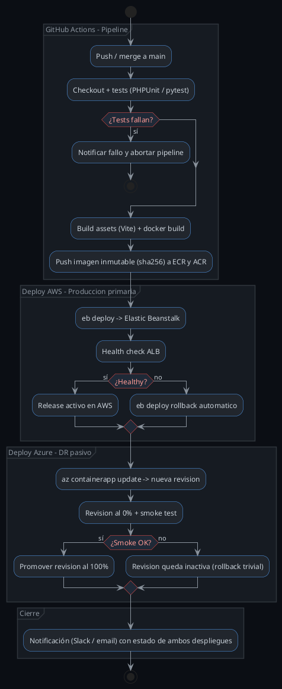

- **AWS/EB**: rollback = `eb deploy` de la versión anterior o "Rollback" en la consola (versionado de releases nativo).
- **Azure/Container Apps**: las revisiones inmutables permiten *traffic splitting* — se despliega la nueva revisión al 0%, se hace smoke test y se promueve al 100%. Rollback = re-etiquetar la revisión anterior.
- **Smoke tests post-deploy** en ambos: `curl /up`, login de prueba, un ciclo esteganografía→descarga.

### 7.5 Diagrama completo del pipeline

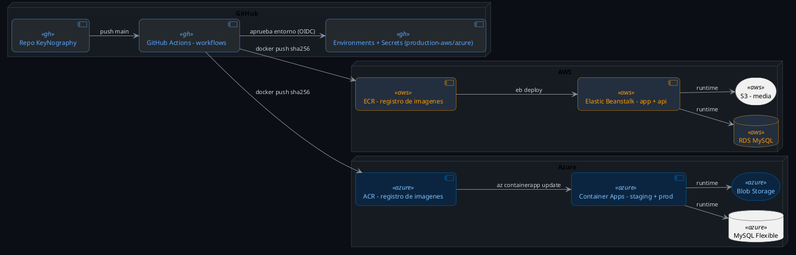

---

## 8. Flujos de datos y secuencias

### 8.1 Flujo principal: esteganografía de imagen

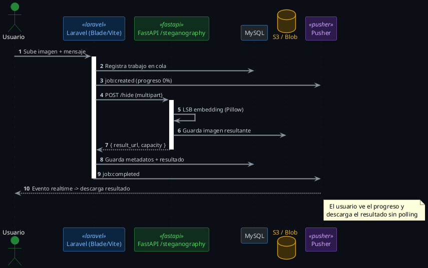

### 8.2 Flujo de lectura de archivos generados

Las imágenes/audio generados viven en object storage. Recomendación: la API devuelve **URLs prefirmadas** (S3) o **SAS tokens** (Blob) con expiración corta en lugar de proxy por Laravel — menos carga y más seguro. En MVP con archivos públicos puede servirse directo desde el bucket/container con URL pública controlada.

---

## 9. Observabilidad y operaciones

| Capacidad | AWS | Azure |
|---|---|---|
| Logs | CloudWatch Logs (EB los envía automático) | Log Analytics (Container Apps envía automático) |
| Métricas | CloudWatch (CPU, ALB 5xx, RDS) | Azure Monitor / Container Apps metrics |
| Errores app | `php artisan` logs → CloudWatch; Sentry *(opcional, free tier)* | Igual → Log Analytics |
| Uptime | Route 53 health checks cada 30 s | Mismos health checks |
| Alertas | CloudWatch Alarms → SNS email (gratis) | Azure Monitor alert rules → email |

Recomendación ligera: **Sentry free tier** (5k errores/mes) en ambas nubes para excepciones de Laravel y FastAPI — un solo panel para el sistema multicloud.

---

## 10. Continuidad de negocio y failover

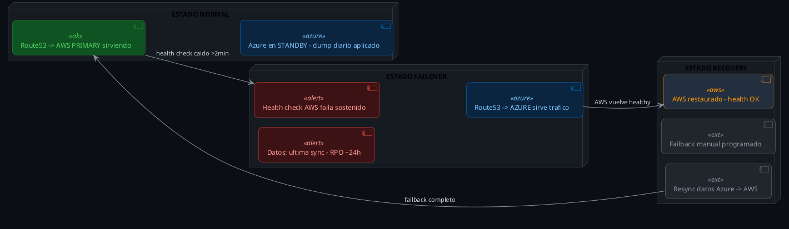

| Métrica | Objetivo MVP | Notas |
|---|---|---|
| **RTO** (tiempo de recuperación) | ~5–15 min | Automático vía DNS; depende del TTL (60s) |
| **RPO** (pérdida de datos) | 24 h (dump diario) | Aceptable para contenido educativo; mejora futura: binlog replication gestionada |
| **Failback** | Manual, ventana programada | Re-sincronizar BD antes de volver el tráfico |

**Procedimiento de failover (runbook):**
1. Confirmar health check caído en Route 53 (o forzar con "Failover" manual en consola).
2. Verificar que Azure responde y que la BD tiene el último dump.
3. DNS conmuta solo; comunicar a usuarios.
4. Post-incidente: restaurar AWS, resincronizar datos, documentar.

---

## 11. Costos estimados (créditos académicos)

| Concepto | AWS/mes | Azure/mes | Notas |
|---|---|---|---|
| Compute app+api | ~$16–25 (2× t3.micro + ALB) | ~$0–10 (consumption) | ALB es el costo fijo principal en AWS |
| Base de datos | ~$15 (RDS t3.micro) | $0 (12 meses gratis B1ms) | |
| Storage | <$1 (S3 5GB gratis) | $0–2 (Blob) | |
| DNS/health checks | ~$1.50 | — | Route 53 |
| **Total estimado** | **~$32–42** | **~$0–12** | Ambos cubiertos por créditos académicos |

Presupuesto sugerido de créditos: **AWS ~$50/mes**, **Azure ~$20/mes** → ~$840/año, dentro de los $100–200 de AWS Academy + $100 Azure for Students si se gestiona bien (Azure sobra; AWS es el que más consume por ALB+RDS).

---

## 12. Roadmap de implementación

| Fase | Entregable | Dependencias |
|---|---|---|
| **0. Prep** | Dockerfiles validados, `.dockerignore`, health endpoints (`/up`, `/health`) | — |
| **1. AWS base** | EB env dev → prod, RDS, S3, ACM, secrets | Cuenta AWS Academy activa |
| **2. CI/CD AWS** | Workflow test→ECR→EB con OIDC | Fase 1 |
| **3. Azure base** | ACR, MySQL Flexible, Container Apps staging | Azure for Students activo |
| **4. CI/CD Azure** | Workflow multi-registry + containerapp update | Fases 2–3 |
| **5. DNS + failover** | Route 53 hosted zone, failover records, health checks | Dominios apuntando |
| **6. DR + runbook** | Dump/restauración programada, simulacro de failover | Fase 5 |
| **7. Endurecimiento** | Réplicas min=2, backups automatizados, alertas, Sentry | Post-MVP |

---

## Anexo A — Checklist de variables de entorno por entorno

- `APP_ENV`, `APP_URL`, `APP_KEY` (por entorno, nunca compartida)
- `DB_*` (endpoint regional de cada nube)
- `FILESYSTEM_DISK` / `AWS_BUCKET` / `AZURE_STORAGE_*`
- `QUEUE_CONNECTION`, `CACHE_STORE` (database en MVP)
- `PUSHER_*` (común)
- `API_URL` (URL pública de la API según proveedor activo)

## Anexo B — Decisiones descartadas (y por qué)

| Alternativa | Por qué no |
|---|---|
| Kubernetes (EKS/AKS) | Sobre-ingeniería para este proyecto; EB+Container Apps dan el mismo resultado con 10% del esfuerzo |
| Replicación activa de BD entre nubes | Complejidad y costo desproporcionados; cold standby + failover DNS cubre el requisito académico |
| Serverless puro (Lambda/Lambda Azure Functions) | Laravel monolítico + sesiones/cola no encaja sin refactor grande |
| Cloudflare como único DNS | Válido, pero Route 53 health checks + failover se integra mejor con AWS y es parte del temario |
